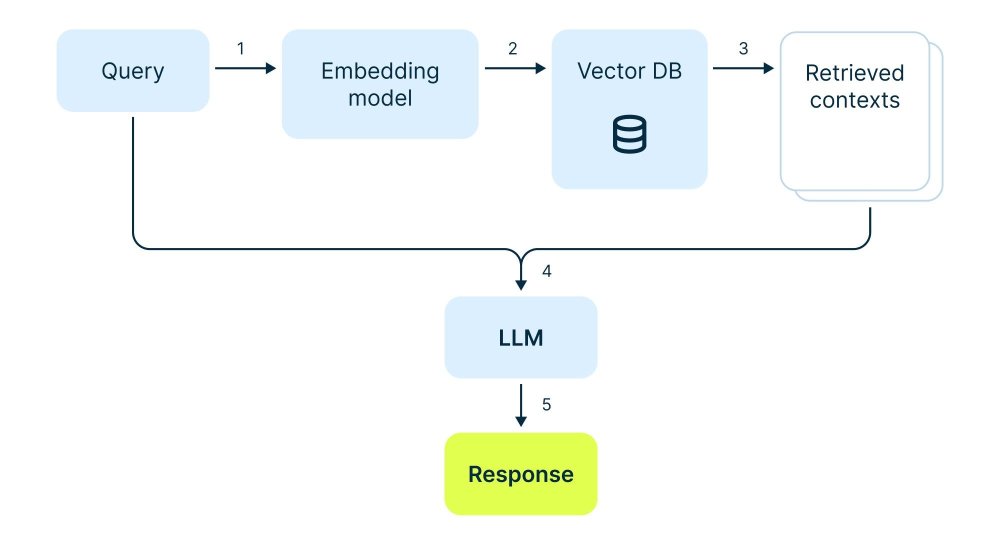

# Intelligent Document Assistant

A backend that turns PDFs and text files into a conversational, source-grounded RAG assistant, with an LLM-driven interview booking flow.

Two REST APIs, built on FastAPI:

1. **Document Ingestion** — upload a `.pdf` / `.txt`, extract text, chunk it with a selectable strategy, embed it, store vectors in Qdrant and metadata in PostgreSQL.
2. **Conversational RAG** — ask questions across your documents with multi-turn memory in Redis, and book an interview by just talking to it.

> **Status:** design phase. The implementation plan lives in [`/spec`](.claude/spec/README.md), [`/plan`](.claude/plan/README.md) and [`/qa`](.claude/qa/README.md). Nothing in this README is claimed to be working yet.

---

## Table of contents

- [Why](#why)
- [Architecture](#architecture)
- [The three data stores](#the-three-data-stores)
- [Tech stack](#tech-stack)
- [API 1 — Document ingestion](#api-1--document-ingestion)
- [Chunking strategies](#chunking-strategies)
- [API 2 — Conversational RAG](#api-2--conversational-rag)
- [Interview booking](#interview-booking)
- [Project structure](#project-structure)
- [Getting started](#getting-started)
- [Design decisions](#design-decisions)
- [Known limitations](#known-limitations)
- [Constraints honoured](#constraints-honoured)

---

## Why

The interesting part of a RAG system is not the API — it is what happens between the upload and the answer:

- How you split a document determines whether a chunk is answerable at all.
- Whether the *follow-up* question ("what about the second one?") resolves to the right passage decides whether multi-turn chat feels intelligent or random.
- Whether a booking request is persisted only after the user explicitly confirms decides whether your database is trustworthy.

So the implementation is deliberately explicit about every stage: extraction, chunking, embedding, retrieval, prompt assembly, answer generation, memory and structured extraction are separate, typed, individually testable modules. No framework hides the interesting parts.

## Architecture

The core retrieval loop:



A user question is embedded with the same model used at ingestion, searched against the vector database, and the retrieved passages are merged with the original question before being handed to the LLM. The answer is grounded in those passages or it says it does not know.

The full system adds two things on top of that loop:

```
                ┌──────────────┐
  upload ──────▶│  Ingestion   │──▶ chunks ──▶ embeddings ──▶ Qdrant
                │  (T04–T10)   │                              (semantics)
                └──────┬───────┘
                       │ metadata
                       ▼
                  PostgreSQL                        Redis
                (documents, bookings)          (conversation memory)
```

## The three data stores

They exist for different reasons and are not interchangeable:

| Store | Holds | Why it is there |
|-------|-------|-----------------|
| **Qdrant** | chunk vectors + payloads | Semantic similarity search. The only store that can answer "which passages are about this question?". |
| **PostgreSQL** | document metadata, interview bookings | Relational truth: what documents exist, what did we chunk them into, who booked what. Transactional and queryable. |
| **Redis** | conversation history per session | Fast, expiring, key-value scratch space for chat memory. A session disappears when it goes idle — that is the desired behaviour, not a bug. |

## Tech stack

| Component | Choice | Rationale |
|-----------|--------|-----------|
| Backend | FastAPI | Async, typed request/response models, auto-generated OpenAPI docs |
| Language | Python 3.11+ | Modern type hints and `X \| Y` syntax |
| Validation | Pydantic v2 | One schema set for HTTP contracts, LLM structured output and config |
| PDF extraction | PyMuPDF | Reliable text extraction, pure wheel, no external binaries |
| Chunking | Hand-written | The assignment asks for two strategies — implementing them is the point |
| Embeddings | sentence-transformers (`all-MiniLM-L6-v2`) | Local, deterministic, free, 384 dimensions |
| Vector DB | Qdrant | Runs embedded on disk or against a server — no cloud account, no container needed; supports payload filtering |
| SQL DB | PostgreSQL + SQLAlchemy 2.0 (async) | Real relational modelling for documents and bookings |
| Migrations | Alembic | Versioned schema, reproducible environments |
| Chat memory | Redis | Session-based history with TTL |
| LLM | OpenAI-compatible client | Swap Gemini / Groq / local vLLM by changing `.env`, not code |
| Tests | pytest + httpx | Fast unit tests with fakes, integration tests against the real stack |

**Why Qdrant and not Pinecone?** Pinecone is a hosted product — it needs an account and network access, and it makes the project impossible to run offline. Qdrant runs embedded on disk (no server, no container) with the same client API it exposes against a server, including payload filters, so the code is portable to Pinecone later if that is ever required.

## API 1 — Document ingestion

```
POST /api/v1/documents/ingest      multipart/form-data
GET  /api/v1/documents             list, paginated, filterable by status
GET  /api/v1/documents/{id}        document detail
GET  /api/v1/documents/{id}/chunks chunk preview
DELETE /api/v1/documents/{id}      removes the row and its vectors
```

Request fields: `file` (the document), `chunking_strategy` (`fixed_size` or `recursive`), and optional `chunk_size` / `chunk_overlap` overrides.

The ingestion flow:

```
validate extension + size
  → SHA-256 content hash (duplicate detection)
  → extract text
  → chunk with the selected strategy
  → embed every chunk
  → upsert vectors + payload to Qdrant
  → write document metadata to PostgreSQL
```

Two details that matter more than they look:

- **Duplicate detection is by content hash, not filename.** Re-uploading the same file returns `409 Conflict` instead of creating a second copy of the same knowledge.
- **PostgreSQL and Qdrant cannot share a transaction.** The row is written first with `status=processing`; if a later step fails, the row is marked `failed`, any partial vectors are deleted, and the request fails loudly. There is no state where a document silently exists in one store and not the other.

## Chunking strategies

Both strategies return the same structure (`content`, `chunk_index`, `document_id`, `token_count`, `metadata`), so they are fully interchangeable downstream.

**A — Fixed size with overlap.** The text is tokenised, then windows of `chunk_size` tokens are emitted, advancing by `chunk_size - chunk_overlap` so consecutive chunks share context. Simple, uniform, and the overlap means a fact split across a boundary is still fully present in one of the chunks.

**B — Recursive character splitting.** The text is split on the most structural separator available — paragraph (`\n\n`), then line (`\n`), then sentence (`. `), then word — recursing into a piece only when it is still too large, and re-merging the pieces back up to `chunk_size` with overlap. A heading stays attached to its paragraph; a sentence is not cut in half.

Fixed-size is predictable and cheap. Recursive produces chunks that a human would recognise as coherent units. Both are selectable per upload, and the strategy used is recorded on the document row.

## API 2 — Conversational RAG

```
POST   /api/v1/chat                    send a message, get an answer
GET    /api/v1/chat/sessions/{id}      inspect the stored conversation
DELETE /api/v1/chat/sessions/{id}      clear a session's history
```

Request:

```json
{ "session_id": "session-123", "message": "What are the main concepts of machine learning?" }
```

Response:

```json
{
  "session_id": "session-123",
  "answer": "Machine learning primarily involves...",
  "sources": [
    { "document_id": "…", "filename": "machine_learning.pdf", "chunk_index": 3, "score": 0.82 }
  ],
  "booking": null,
  "context_used": true
}
```

### The custom RAG pipeline

No `RetrievalQAChain`, no LangChain. Each stage is explicit:

1. **Load history** from Redis for the session.
2. **Contextualise the question.** "What about the second one?" is useless on its own. If there is history, an LLM rewrites the question into a standalone one ("What are the advantages of supervised learning?"). With no history, no LLM call is made at all.
3. **Embed** the rewritten question with the ingestion-time model.
4. **Retrieve** the top-k chunks from Qdrant, optionally filtered to specific documents.
5. **Assemble the prompt** — system rules plus the retrieved context, the conversation history and the original question.
6. **Generate** the answer.
7. **Persist** both messages to Redis, refreshing the session TTL.

The rewritten question is used **only** for retrieval. The answer is always generated against what the user actually asked.

Two guards keep the answer honest: the system prompt forbids inventing information and requires the model to say when the documents do not contain the answer, and the retrieved context is returned as `sources` so every claim can be traced back to a file and a chunk index.

## Interview booking

Booking is a different problem from asking a question, so it gets a different path — but it is still the same conversation.

```
User: I want to schedule an interview.
Bot:  Sure — may I have your name, email, date and time?
User: Sahil Duwal, sahil@example.com, November 20 2026, 2 PM.
Bot:  Here is what I have: … Please confirm to book.
User: yes
Bot:  Your interview request for 2026-11-20 at 14:00 has been recorded.
```

- **Intent detection and extraction are one LLM call** returning a Pydantic-validated object (`is_booking_request`, `name`, `email`, `date`, `time`). The model is instructed never to invent a value it was not given; a missing field stays missing.
- **Partial details accumulate in Redis** under `booking_draft:{session_id}`, so a bare "November 20" is understood in context and a corrected value ("actually, call me Sahil") overwrites the old one.
- **Nothing is written to PostgreSQL until the user explicitly confirms.** "Hmm" is not a confirmation. This is the single rule that makes the bookings table trustworthy.
- **The assistant records a request** — it does not claim an interview with an employer is scheduled, because there is no calendar integration behind it.

## Project structure

Layered so that each concern can be tested on its own:

```
app/
├── api/          # routers — HTTP only, no business logic
│   └── v1/       # documents.py, chat.py
├── core/         # settings, logging, exception types
├── schemas/      # Pydantic request/response models
├── models/       # SQLAlchemy ORM models
├── services/     # business logic (ingestion, rag, retrieval, booking, …)
├── chunking/     # the two strategies + factory
├── repositories/ # SQL, isolated from services
├── integrations/ # Qdrant, Redis, LLM client
├── db/           # engine, session, Base
└── utils/        # PDF and text extraction

tests/{unit,integration}/
scripts/          # init_qdrant.py
```

The dependency direction is one-way: `api → services → repositories/integrations`. Services never import from `api`, and the API layer never touches a database session directly.

## Getting started

Intended quickstart (once implemented — see the status note at the top):

```bash
# 1. infrastructure — native services, no containers
sudo pacman -S postgresql redis           # once
sudo ./scripts/setup_local.sh             # init + start postgres, start redis

# 2. application
uv sync
uv run alembic upgrade head                # create the schema
uv run uvicorn app.main:app --reload      # http://localhost:8000/docs

# 3. ingest a document
curl -F file=@machine_learning.pdf -F chunking_strategy=recursive \
     http://localhost:8000/api/v1/documents/ingest

# 4. ask a question
curl -X POST http://localhost:8000/api/v1/chat \
     -H 'Content-Type: application/json' \
     -d '{"session_id":"demo","message":"What is supervised learning?"}'
```

Configuration is entirely environment-driven (`app/core/config.py`); `.env.example` documents every variable. Secrets live in `.env`, which is not committed.

## Design decisions

A few choices worth defending in a review:

- **Chunkers are pure and synchronous.** No I/O, no globals, no config reads from inside them — so they are trivially testable and the strategy is chosen in exactly one place (the factory).
- **Token counting is a whitespace estimate, not a model tokenizer.** It is approximate. A `ponytail:` comment in the code marks the ceiling and the upgrade path.
- **Embedding model truncation is a real constraint.** `all-MiniLM-L6-v2` truncates at 256 word-pieces, so the default chunk size is 200 words, not the 500 you see in most tutorials. Chunks larger than that would be silently truncated and lose their tails.
- **The embedding model loads lazily.** `torch` is a 2 GB dependency; importing it at startup would make boot slow and the test suite painful.
- **The booking check runs before retrieval.** It is cheap and unambiguous, and a booking request should not pull document context into its reply.
- **Qdrant payloads carry the chunk text.** Retrieval never re-embeds; the trade-off is payload size, which is acceptable at this scale.
- **One uniform error envelope** for every failure — `{"error": {"code", "message", "details", "request_id"}}` — so a client never has to parse two error formats.

## Known limitations

Stated up front rather than discovered later:

- No authentication or rate limiting — out of scope for this assignment, but the routes are structured so a dependency can be added in one place.
- No streaming responses.
- No reranking — retrieval is single-stage vector search. A cross-encoder would help only if evaluation shows recall is the bottleneck.
- Scanned / image-only PDFs are not supported (no OCR).
- The embedding model is loaded per process, so scaling out means scaling memory.
- The booking intent check costs one extra LLM call per chat turn.
- Postgres and Qdrant are not updated in a single transaction; the compensating-delete approach in the ingestion service is the mitigation, not a guarantee.

## Constraints honoured

- ❌ No FAISS
- ❌ No Chroma
- ❌ No `RetrievalQAChain`
- ❌ No LangChain
- ❌ No UI
- ✅ Two selectable chunking strategies, implemented from scratch
- ✅ Custom RAG pipeline, every stage explicit
- ✅ Redis-backed multi-turn conversation memory
- ✅ LLM-driven structured booking extraction with explicit user confirmation
- ✅ Clean modular code with full type annotations
